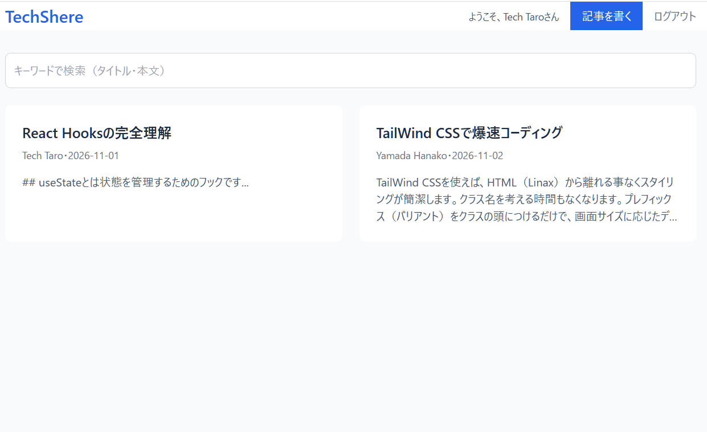

# 技術ナレッジ共有アプリ

## 1. アプリの概要

アイデアや技術を気軽にマークダウン形式で書き込んで共有できるwebアプリ
閲覧・検索ができ、投稿画面ではリアルタイムで表示結果を確認できます。

   **デモ**：https://tech-share-app-three.vercel.app/

## 画面

   

## 2. 技術スタックと選んだ理由

- React --------- コンポーネント単位でUIを管理でき、react-router-dom や react-markdown などの便利なライブラリが使えるため。
- Vite ----------- ファイル準備などが要らず、手元でも動作確認ができてReactの開発をすぐに始めることができる。
- Tailwind CSS -- Reactと相性が良く、ファイル移動の必要がないため素早くスタイリングが可能。
- ContextAPI --- ログイン情報を無駄なく共有化。
- json-server --- 簡単な仮のバックエンドを使う事によりフロントエンド開発に集中できる。

## 3. 工夫した点・難しかった点

Context APIでログイン状態を共有。
Reactによるヘッダーとそれ以外でわけることによる読み込みを最小限にしました。
AtomicDesignを意識したコンポーネント設計で再利用を高めます。
カスタムフックに検索ロジックを分離するのが難しかったです。Tailwind CSSの独自クラスを覚えるともっと楽になるだろうと感じました。
今後の課題としては、ログインは練習用のボタンだけなので、本物のログイン（名前とパスワード）に変えたい。

## 4. ローカルでの起動手順

起動手順の流れ

1. Docker Desktop を起動する
2. PowerShell でDockerコンテナを起動する（ターミナル1）
   docker run -it --rm -v D:\nodeapp:/app -w /app -p 5173:5173 -p 3000:3000 --entrypoint sh node:26-slim
3. 初回だけ、プロジェクトフォルダで部品をインストールする
   cd /app/myapp/tech-share-app && npm install
4. プロジェクトの直下に .env ファイルを作り、次の1行を書く（API の URL を入れるメモ帳）
   VITE_API_URL=http://127.0.0.1:3000
5. ターミナル1でVite（画面）を起動する
   npm run dev -- --host 0.0.0.0
6. 別のPowerShellを開き、docker ps でコンテナ名を調べて入る（ターミナル2）
   docker exec -it コンテナ名 sh
7. ターミナル2でJSON Server（データ）を起動する
   cd /app/myapp/tech-share-app && npx json-server --watch db.json --host 0.0.0.0 --port 3000
8. ブラウザで http://127.0.0.1:5173/ を開く